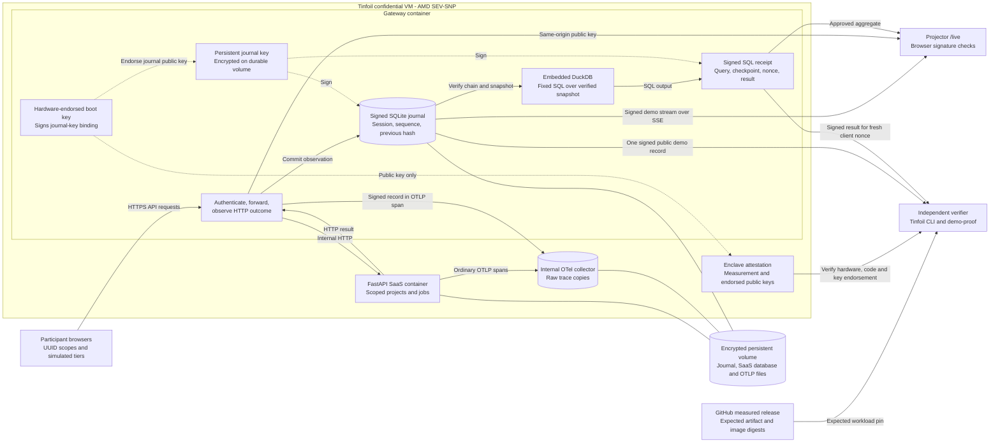
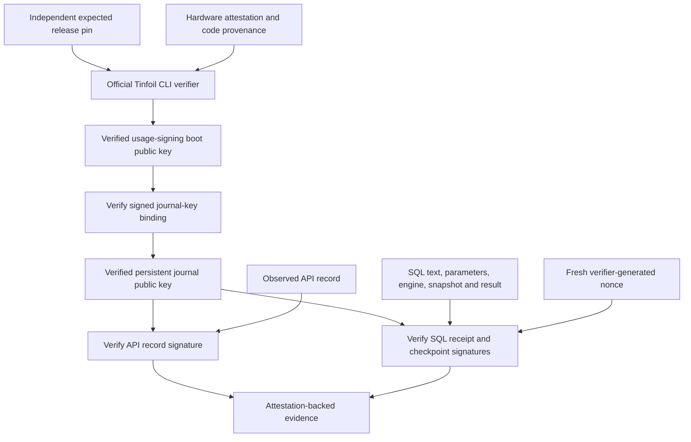

# System and trust boundaries

Current deployment: https://dataroom-gateway.akan72.containers.tinfoil.dev/

The approved release, tag, and artifact digest are pinned in
[`deploy/release.json`](../deploy/release.json). The image and closed network are
defined by [`tinfoil-config.yml`](../tinfoil-config.yml).

The private signing key never leaves the enclave. The dashed signing arrows are
operations inside the gateway, not exported key material. The collector has no
public ingress and there is no external OTel export in this deployment. The journal,
not the secondary trace copy, determines signed SQL results.

## How the attestation reaches the data

There is no hardware quote for every request. Hardware attests the approved workload
and endorses a boot key; that key binds the persistent journal key which signs observations and receipts. The
independent verifier extracts the endorsed public key and checks the actual data
signatures. Browser checkmarks alone only establish signature validity under the
key the page obtained from its own origin. `make demo-proof` supplies the independent
hardware/code/key verification that connects those signatures to the enclave.

The SQL guarantee is **TEE-attested execution of approved code**, not a zero-knowledge
SQL proof. The approved code verifies the journal snapshot, runs the fixed query in
DuckDB, and signs the query/checkpoint/nonce/result together. A valid nonce-bound
signature under the endorsed key therefore attributes that execution to the approved
gateway. An arbitrary signed SQL string without that approved execution path would
not establish correct execution.

## Boundaries to say out loud

- The public stream contains synthetic demo activity. Private customer data must not
  be served with public demo mode enabled.
- One signed sample does not prove complete capture. Snapshot-chain checks establish
  the retained prefix; they do not establish all-company traffic coverage or real demand.
- Simulated tiers and UUID scopes are not independently verified paid customers.
- An encrypted volume retains data across boots. It needs the original locally held
  unlock key after independent attestation. Disk rollback is not automatically detected.
  Hardware trust is never inferred from a server flag. See [storage](STORAGE.md).

See the [presenter walkthrough](LIVE_DEMO.md) for the live sequence.
